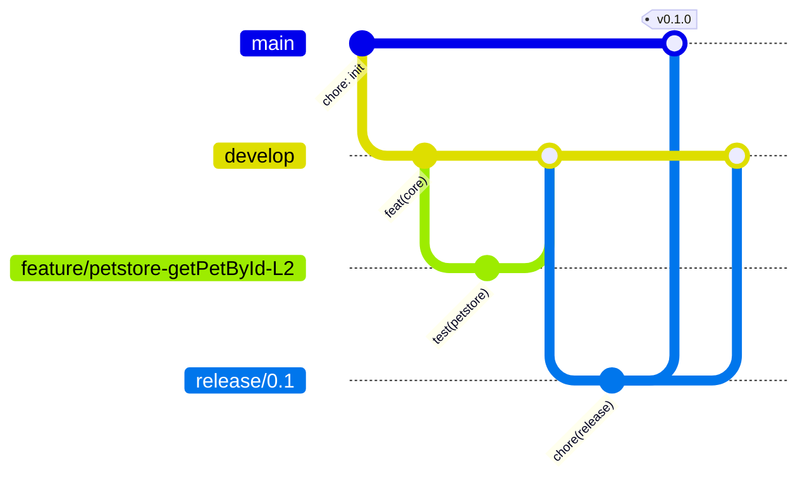

# Git flow

| Branch                       | From      | Into                          | Rule                                                                                                          |
| ---------------------------- | --------- | ----------------------------- | ------------------------------------------------------------------------------------------------------------- |
| `main`                       | —         | —                             | Release only. PRs from `release/*` or `hotfix/*` (and `develop` if no release branch). Never commit directly. |
| `develop`                    | `main`    | `release/*`                   | Integration. PR + green checks required.                                                                      |
| `feature/<target>-<op>-L<n>` | `develop` | `develop`                     | One op + one level per branch (keeps PRs reviewable and parallel agents conflict-free).                       |
| `fix/*`                      | `develop` | `develop`                     | Test or framework fix.                                                                                        |
| `release/x.y`                | `develop` | `main` + back-merge `develop` | Version bump, changelog only.                                                                                 |
| `hotfix/*`                   | `main`    | `main` + `develop`            | Urgent fix of a broken `main`.                                                                                |

## Why `main` stays green

1. `.githooks/pre-push` refuses pushes to `main`/`develop` and runs lint + typecheck + mock smoke. Install once: `npm run hooks:install`.
2. `.githooks/commit-msg` enforces Conventional Commits (`type(scope): subject`).
3. Server-side (configure in Bitbucket/GitHub — not possible from this repo): protect `main` and `develop`, require PR, 1 approval + CODEOWNERS, required checks (lint, typecheck, smoke), no force push, admins included.
4. Reviewer agent (`.claude/agents/reviewer.md`) runs on every PR before a human approves.

## Parallel agents

`git worktree add ../poc-<branch> -b <branch> develop` — one agent per worktree, one op/level per branch. Generated files (`map/*`) are the usual conflict: regenerate, don't hand-merge.
