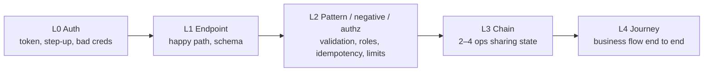
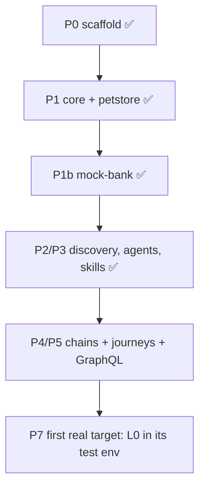

# Roadmap (spiral outward)

Each API moves outward one ring at a time; a ring is entered only when the inner ring is green for that API.

Live status per phase is in [../STATUS.md](../STATUS.md). Per-API ring reached: `targets/<t>/map/coverage.md`.

## Suggested spiral order for a banking target

1. L0: service tokens per domain identity; user logon + OTP step-up per role.
2. L1: reference reads (next business day, customer info, limits, accounts).
3. L2: authz matrix (4 roles), limits read-then-size, idempotency, restrictions.
4. L3: onboarding → fund → transfer → verify balances and utilized limits.
5. L4: open account → add payee → transfer → statement.
