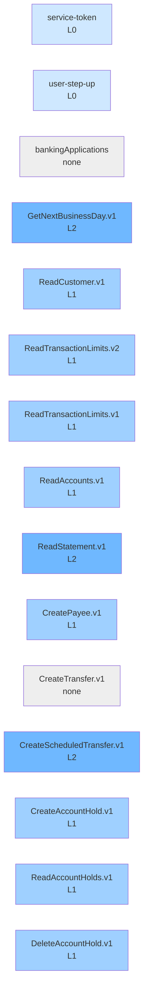

# mock-bank coverage

Generated by `node tools/coverage.ts mock-bank`. 11/15 ops have L1+ tests. Cells = tagged occurrences per level file (approximate).

| op | L0 | L1 | L2 | L3 | L4 |
|---|---|---|---|---|---|
| service-token | 1 | · | · | · | · |
| user-step-up | 1 | · | · | · | · |
| bankingApplications | · | · | · | · | · |
| GetNextBusinessDay.v1 | · | 1 | 2 | · | · |
| ReadCustomer.v1 | · | 1 | · | · | · |
| ReadTransactionLimits.v2 | · | 2 | · | · | · |
| ReadTransactionLimits.v1 | · | 1 | · | · | · |
| ReadAccounts.v1 | · | 1 | · | · | · |
| ReadStatement.v1 | · | · | 1 | · | · |
| CreatePayee.v1 | · | 1 | · | · | · |
| CreateTransfer.v1 | · | · | · | · | · |
| CreateScheduledTransfer.v1 | · | · | 1 | · | · |
| CreateAccountHold.v1 | · | 1 | · | · | · |
| ReadAccountHolds.v1 | · | 1 | · | · | · |
| DeleteAccountHold.v1 | · | 1 | · | · | · |

