# petstore coverage

Generated by `node tools/coverage.ts petstore`. 8/19 ops have L1+ tests. Cells = tagged occurrences per level file (approximate).

| op | L0 | L1 | L2 | L3 | L4 |
|---|---|---|---|---|---|
| updatePet | · | 1 | · | · | · |
| addPet | · | 1 | 2 | · | · |
| findPetsByStatus | · | 1 | 1 | · | · |
| findPetsByTags | · | · | · | · | · |
| getPetById | · | 1 | 2 | · | · |
| updatePetWithForm | · | · | · | · | · |
| deletePet | · | 1 | · | · | · |
| uploadFile | · | · | · | · | · |
| getInventory | · | 1 | · | · | · |
| placeOrder | · | 1 | 1 | · | · |
| getOrderById | · | 1 | 2 | · | · |
| deleteOrder | · | · | · | · | · |
| createUser | · | · | · | · | · |
| createUsersWithListInput | · | · | · | · | · |
| loginUser | 1 | · | · | · | · |
| logoutUser | · | · | · | · | · |
| getUserByName | · | · | · | · | · |
| updateUser | · | · | · | · | · |
| deleteUser | · | · | · | · | · |

```mermaid
flowchart LR
  updatePet["updatePet<br/>L1"]
  addPet["addPet<br/>L2"]
  findPetsByStatus["findPetsByStatus<br/>L2"]
  findPetsByTags["findPetsByTags<br/>none"]
  getPetById["getPetById<br/>L2"]
  updatePetWithForm["updatePetWithForm<br/>none"]
  deletePet["deletePet<br/>L1"]
  uploadFile["uploadFile<br/>none"]
  getInventory["getInventory<br/>L1"]
  placeOrder["placeOrder<br/>L2"]
  getOrderById["getOrderById<br/>L2"]
  deleteOrder["deleteOrder<br/>none"]
  createUser["createUser<br/>none"]
  createUsersWithListInput["createUsersWithListInput<br/>none"]
  loginUser["loginUser<br/>L0"]
  logoutUser["logoutUser<br/>none"]
  getUserByName["getUserByName<br/>none"]
  updateUser["updateUser<br/>none"]
  deleteUser["deleteUser<br/>none"]
  style updatePet fill:#9fd0ff
  style addPet fill:#6fb8ff
  style findPetsByStatus fill:#6fb8ff
  style findPetsByTags fill:#eee
  style getPetById fill:#6fb8ff
  style updatePetWithForm fill:#eee
  style deletePet fill:#9fd0ff
  style uploadFile fill:#eee
  style getInventory fill:#9fd0ff
  style placeOrder fill:#6fb8ff
  style getOrderById fill:#6fb8ff
  style deleteOrder fill:#eee
  style createUser fill:#eee
  style createUsersWithListInput fill:#eee
  style loginUser fill:#cfe8ff
  style logoutUser fill:#eee
  style getUserByName fill:#eee
  style updateUser fill:#eee
  style deleteUser fill:#eee
```

